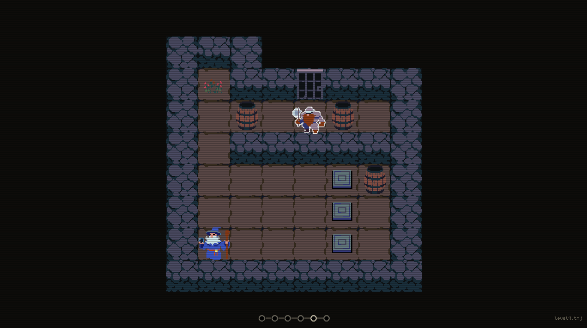

# Sokoban v2

A fantasy Sokoban puzzle where heroes use unique abilities to move blocks and reach each level's goals.



## Game

With [LÖVE](https://love2d.org/) installed:

```sh
love .
```

## Testing

With `lua` installed:

```sh
lua tests/run.lua
```

## Desktop builds

On macOS, with `curl`, `zip`, and `ditto` available:

```sh
./scripts/build-desktop.sh
```

This creates a Windows x64 folder/ZIP and a macOS `.app`/ZIP under `dist/desktop/`. To create only one platform, pass `windows` or `macos`.

### Publishing a new version

Desktop builds on `main` are uploaded as workflow artifacts. To publish downloadable files as a GitHub Release, create and push a version tag after the release changes have been committed:

```sh
git switch main
git pull --ff-only
git tag -a vX.Y.Z -m "Release vX.Y.Z"
git push origin vX.Y.Z
```

Replace `X.Y.Z` with the new version number (for example, `v0.2.0`). Pushing a `v*` tag runs the desktop build and creates a GitHub Release with generated changelog notes and the Windows/macOS ZIP files. Check the **Desktop builds** workflow in GitHub Actions to follow the build and publication.
